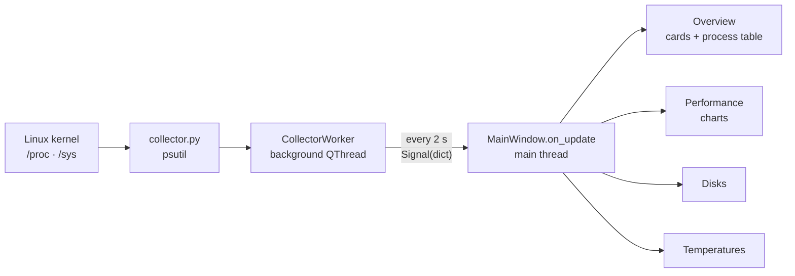

<div align="center">

# SysDash — Linux Health Dashboard

**A modern, lightweight, real-time system health desktop app for Linux.**

Shows CPU, RAM, disk, temperature and, most importantly, running processes in a single window, refreshed every 2 seconds.


**English** · [Türkçe](README.tr.md)

<br>


</div>

> The app's user interface is in Turkish.

---

## Table of contents

- [Features](#features)
- [Screenshots](#screenshots)
- [Installation](#installation)
- [Usage](#usage)
- [Project structure](#project-structure)
- [Architecture](#architecture)
- [Technical notes](#technical-notes)
- [Packaging](#packaging)
- [Troubleshooting](#troubleshooting)
- [Roadmap](#roadmap)
- [Contributing](#contributing)

## Features

### Overview
- **CPU, RAM, disk and temperature cards:** each card has a ring gauge that animates smoothly as the value changes, plus a sparkline of the last minute
- **Color warnings:** a card turns orange when its value crosses the warning threshold and red at the critical level

| Metric | Warning (orange) | Critical (red) |
|---|---|---|
| CPU | 70% | 90% |
| RAM | 80% | 92% |
| Disk | 80% | 90% |
| Temperature | 70 °C | 85 °C |

### Process management
- **Live process table:** PID, name, user, CPU, memory, RAM %, thread count, status and command line
- **Search:** instant filtering across every column, including name, user, PID, command and status
- **Sorting:** click any column header
- **Load-colored CPU bars** and **colored status badges** (running, sleeping, zombie…)
- **Right-click menu:** terminate (SIGTERM) or force kill (SIGKILL) a process, with a confirmation dialog
- **Smart updates:** the table is not reset on every refresh, so the selected row and scroll position are kept

### Other pages
- **Performance:** CPU and RAM charts for the last 3 minutes, plus live per-core usage
- **Disks:** used / total space and a usage bar for every mount point
- **Temperatures:** all hardware sensors (hwmon / lm-sensors), with a helpful empty state when there are none

### Interface
- **Sidebar** navigation between pages
- **Dark and light themes:** switch with one click; your choice is saved and the first launch follows the system theme
- Numbers use a monospaced font, so the table doesn't jitter as values change

## Screenshots

| Performance | Disks | Temperatures |
|:---:|:---:|:---:|
|  |  |  |

Screenshots were taken on Kali Linux in a VirtualBox virtual machine, which is why no temperature sensors are listed. Click an image to view it at full size.

## Installation

### Requirements

- Linux (Ubuntu, Debian, Kali, Mint, etc.)
- Python 3.10 or newer

### Steps

Install the system packages:

```bash
sudo apt update && sudo apt install -y python3-venv python3-pip libxcb-cursor0
```

Clone the project:

```bash
git clone https://github.com/1Batuhan1/Health-Dashboard.git
cd Health-Dashboard
```

Create a virtual environment and install the dependencies:

```bash
python3 -m venv .venv
source .venv/bin/activate
pip install -r requirements.txt
```

Install the recommended fonts (optional; similar system fonts are used if they're missing):

```bash
sudo apt install -y fonts-inter fonts-jetbrains-mono
```

## Usage

Start the app:

```bash
python main.py
```

To test only the data collection layer, without the UI (prints the results as JSON):

```bash
python collector.py
```

### Command-line options

| Option | Description |
|---|---|
| `--theme dark\|light` | Overrides the saved theme for this launch only |
| `--page 0-3` | Page to show on launch (0: Overview, 1: Performance, 2: Disks, 3: Temperatures) |
| `--screenshot FILE` | Saves a screenshot of the window and exits (for development) |
| `--delay SECONDS` | How long to wait before `--screenshot` (default 9) |

Example: take a screenshot of the Performance page in the light theme after 20 seconds:

```bash
python main.py --theme light --page 1 --delay 20 --screenshot performance.png
```

### Adding it to the application menu

Edit the `Exec=` line in `sysdash.desktop` to point to the app, then copy it:

```bash
cp sysdash.desktop ~/.local/share/applications/
```

## Project structure

```
Health-Dashboard/
├── main.py            # Main window, sidebar, pages and data flow
├── collector.py       # Metric collection with psutil (UI-independent)
├── process_model.py   # Qt model for the process table
├── delegates.py       # CPU bar and status badge cells in the table
├── widgets.py         # Ring gauge, sparkline, cards and charts
├── theme.py           # Dark/light palette, Qt style sheet and fonts
├── formatting.py      # Byte and duration formatting
├── sysdash.desktop    # Linux application menu entry
└── requirements.txt   # Python dependencies
```

## Architecture



Data collection and the UI are kept separate. `collector.py` contains no Qt code, so it can be run and tested on its own.

### Built with

| Technology | Purpose |
|---|---|
| [PySide6](https://doc.qt.io/qtforpython-6/) | Qt 6 desktop UI |
| [psutil](https://github.com/giampaolo/psutil) | CPU, RAM, disk, sensor and process information |
| [pyqtgraph](https://www.pyqtgraph.org/) | Fast, live charts |
| [qtawesome](https://github.com/spyder-ide/qtawesome) | Material Design icons |

The UI doesn't use a ready-made theme library. Styling comes from the Qt style sheet (QSS) in `theme.py`, and the gauges and bars are custom widgets drawn with `QPainter`.

## Technical notes

<details>
<summary><b>Why doesn't the UI freeze?</b></summary>

Data is collected in a separate `QThread`. Scanning hundreds of processes can take a few hundred milliseconds; doing that on the UI thread would make the window stutter on every refresh.

Only the main thread touches the UI: `on_update` is marked with `@Slot` and connected to the signal with `Qt.QueuedConnection`. This follows Qt's thread-safety rules.
</details>

<details>
<summary><b>How is CPU usage calculated?</b></summary>

psutil's `cpu_percent()` is calculated from the difference between two calls, so the first measurement always returns 0. The app therefore discards one measurement at startup and calls psutil from a single place at a regular interval.

Unlike htop, per-process CPU usage is **relative to total CPU capacity** (divided by the number of cores). That way, the sum over all processes is at most 100%.
</details>

<details>
<summary><b>Is stopping processes safe?</b></summary>

- Every action asks for confirmation first.
- If a process has exited and its PID was reused by another process, the start times are compared so the wrong process is never stopped.
- The app runs with normal user permissions and shows a warning for processes owned by other users. Running the app with `sudo` is not recommended.
</details>

<details>
<summary><b>Why is the command column empty for some processes?</b></summary>

On Linux these are mostly **kernel threads** (`kworker`, `ksoftirqd`, `rcu_*`, etc.). They aren't started from a program on disk, so they have no command line; `ps -ef` shows their names in square brackets. Zombie processes also have an empty command line.
</details>

## Packaging

To build a single-file executable:

```bash
pip install pyinstaller
pyinstaller --onefile --name sysdash main.py
```

You can place the resulting `dist/sysdash` file in, for example, `/opt/sysdash/`. AppImage or `.deb` (e.g. with `fpm`) are good options for distribution.

> **Note:** Flatpak and Snap run apps in a sandbox that can't see the host's processes, so they aren't suitable for this app.

## Troubleshooting

| Problem | Solution |
|---|---|
| `Could not load the Qt platform plugin "xcb"` | `sudo apt install libxcb-cursor0` |
| `ensurepip is not available` | `sudo apt install python3-venv` |
| `externally-managed-environment` | The virtual environment isn't active: `source .venv/bin/activate` |
| Temperatures page is empty | Expected in a virtual machine. On physical hardware: `sudo apt install lm-sensors && sudo sensors-detect` |
| Window doesn't open on Wayland | Try `QT_QPA_PLATFORM=xcb python main.py` |
| "Yetki yok" (permission denied) warning | The process belongs to another user; use `pkexec kill <PID>` from a terminal |

## Roadmap

- [x] Live CPU, RAM, disk and temperature monitoring
- [x] Searchable, sortable process table
- [x] Stopping processes
- [x] Dark / light theme
- [ ] Process details window (threads, open files, network connections)
- [ ] Process tree view
- [ ] Network and disk read/write speeds
- [ ] System tray icon and desktop notifications when thresholds are exceeded
- [ ] Settings window (refresh interval, thresholds)
- [ ] Recording measurement history and exporting it
- [ ] Security panel: suspicious processes and listening ports

## Contributing

1. Fork the repository
2. Create a branch: `git checkout -b feature/feature-name`
3. Commit your changes: `git commit -m "Add: ..."`
4. Push the branch: `git push origin feature/feature-name`
5. Open a Pull Request

Use the [Issues](https://github.com/1Batuhan1/Health-Dashboard/issues) page for bug reports and suggestions.
