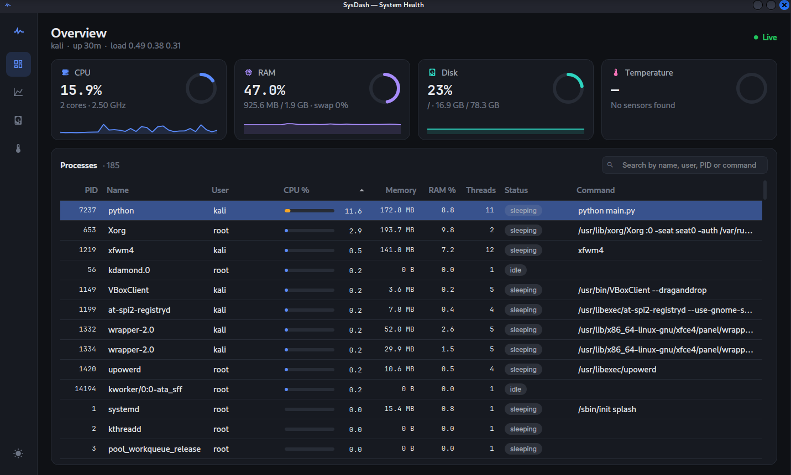
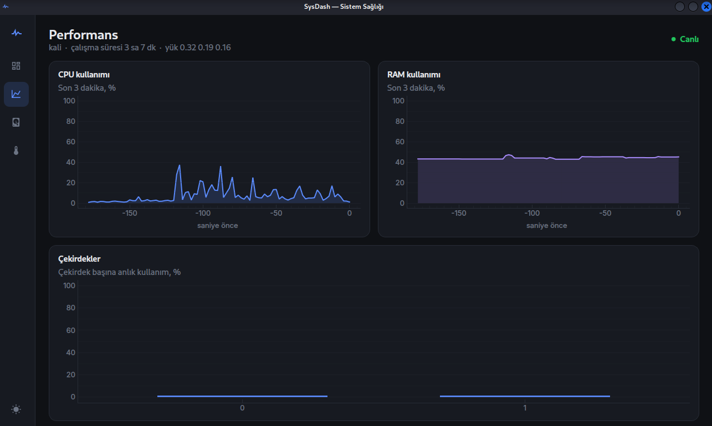
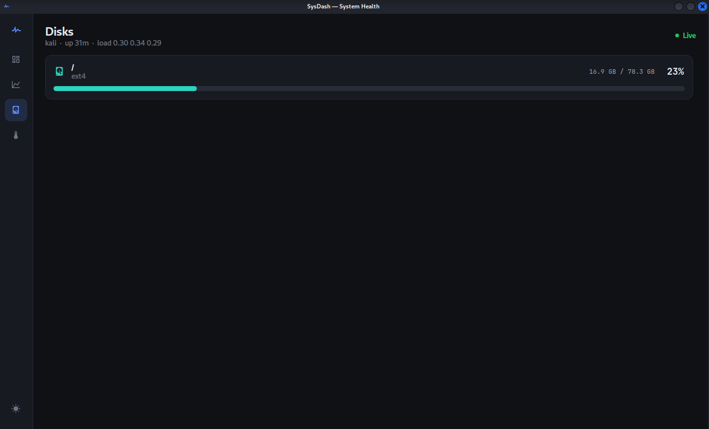
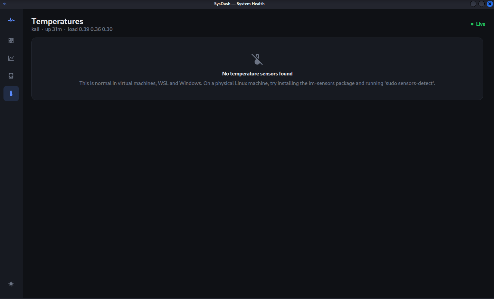
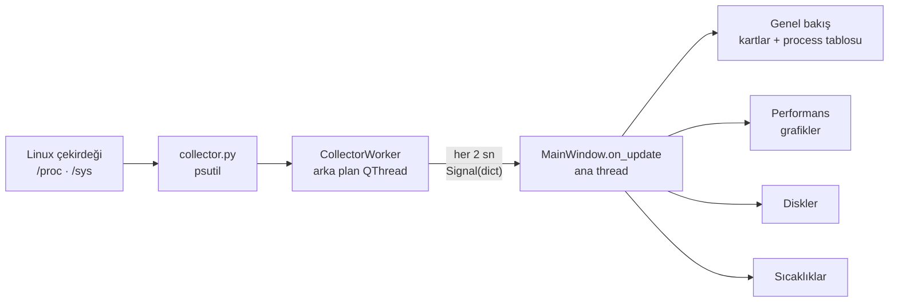

<div align="center">

# SysDash — Linux Health Dashboard

**Linux için modern, hafif ve canlı bir sistem sağlığı masaüstü uygulaması.**

CPU, RAM, disk, sıcaklık ve en önemlisi çalışan processleri tek pencerede, 2 saniyede bir güncelleyerek gösterir.


[English](README.md) · **Türkçe**

<br>



</div>

> Uygulamanın arayüzü İngilizcedir.

---

## İçindekiler

- [Özellikler](#özellikler)
- [Ekran görüntüleri](#ekran-görüntüleri)
- [Kurulum](#kurulum)
- [Kullanım](#kullanım)
- [Proje yapısı](#proje-yapısı)
- [Mimari](#mimari)
- [Teknik notlar](#teknik-notlar)
- [Paketleme](#paketleme)
- [Sorun giderme](#sorun-giderme)
- [Yol haritası](#yol-haritası)
- [Katkıda bulunma](#katkıda-bulunma)

## Özellikler

### Genel bakış
- **CPU, RAM, disk ve sıcaklık kartları:** her kartta değer değiştikçe yumuşakça dolan dairesel gösterge ve son 1 dakikanın mini grafiği
- **Renkle uyarı:** değerler eşiği aşınca kart rengi turuncuya, kritik seviyede kırmızıya döner

| Metrik | Uyarı (turuncu) | Kritik (kırmızı) |
|---|---|---|
| CPU | %70 | %90 |
| RAM | %80 | %92 |
| Disk | %80 | %90 |
| Sıcaklık | 70 °C | 85 °C |

### Process yönetimi
- **Canlı process tablosu:** PID, isim, kullanıcı, CPU, bellek, RAM %, thread sayısı, durum ve komut
- **Arama:** isim, kullanıcı, PID, komut ve durum dahil tüm sütunlarda anında filtreleme
- **Sıralama:** herhangi bir sütun başlığına tıklayarak
- **Yüke göre renklenen CPU çubukları** ve **renkli durum etiketleri** (running, sleeping, zombie…)
- **Sağ tık menüsü:** process'i sonlandırma (SIGTERM) veya zorla öldürme (SIGKILL), onay penceresiyle
- **Akıllı güncelleme:** tablo her yenilemede sıfırlanmaz; seçili satır ve kaydırma konumu korunur

### Diğer sayfalar
- **Performans:** son 3 dakikanın CPU ve RAM grafiği, çekirdek başına anlık kullanım
- **Diskler:** her bağlama noktası için kullanılan / toplam alan ve doluluk çubuğu
- **Sıcaklıklar:** tüm donanım sensörleri (hwmon / lm-sensors); sensör yoksa açıklayıcı bir ekran

### Arayüz
- **Yan menü** ile sayfalar arasında geçiş
- **Koyu ve açık tema:** tek tıkla değişir, seçim kaydedilir, ilk açılışta sistem temasına uyar
- Sayılar sabit genişlikli yazı tipiyle gösterilir; değerler değişirken tablo titremez

## Ekran görüntüleri

| Performans | Diskler | Sıcaklıklar |
|:---:|:---:|:---:|
|  |  |  |

Görüntüler VirtualBox sanal makinesinde çalışan Kali Linux'ta alındı; sıcaklık sensörünün görünmemesi bu yüzden. Görseli tam boyutta görmek için üzerine tıkla.

## Kurulum

### Gereksinimler

- Linux (Ubuntu, Debian, Kali, Mint vb.)
- Python 3.10 veya üzeri

### Adımlar

Sistem paketlerini kur:

```bash
sudo apt update && sudo apt install -y python3-venv python3-pip libxcb-cursor0
```

Projeyi indir:

```bash
git clone https://github.com/1Batuhan1/Health-Dashboard.git
cd Health-Dashboard
```

Sanal ortamı oluştur ve bağımlılıkları yükle:

```bash
python3 -m venv .venv
source .venv/bin/activate
pip install -r requirements.txt
```

Önerilen yazı tiplerini kur (isteğe bağlı; kurulu değilse sistemdeki benzerleri kullanılır):

```bash
sudo apt install -y fonts-inter fonts-jetbrains-mono
```

## Kullanım

Uygulamayı başlat:

```bash
python main.py
```

Sadece veri toplama katmanını, arayüz olmadan test etmek için (sonuçları JSON olarak yazdırır):

```bash
python collector.py
```

### Komut satırı seçenekleri

| Seçenek | Açıklama |
|---|---|
| `--theme dark\|light` | Kayıtlı temayı yalnızca bu açılış için geçersiz kılar |
| `--page 0-3` | Açılışta gösterilecek sayfa (0: Overview, 1: Performance, 2: Disks, 3: Temperatures) |
| `--screenshot DOSYA` | Pencerenin görüntüsünü kaydedip kapanır (geliştirme için) |
| `--delay SANİYE` | `--screenshot` öncesi bekleme süresi (varsayılan 9) |

Örnek: açık temada Performans sayfasının görüntüsünü 20 saniye sonra al:

```bash
python main.py --theme light --page 1 --delay 20 --screenshot performans.png
```

### Uygulama menüsüne ekleme

`sysdash.desktop` dosyasındaki `Exec=` satırını uygulamanın yoluna göre düzenleyip kopyala:

```bash
cp sysdash.desktop ~/.local/share/applications/
```

## Proje yapısı

```
Health-Dashboard/
├── main.py            # Ana pencere, yan menü, sayfalar ve veri akışı
├── collector.py       # psutil ile metrik toplama (arayüzden bağımsız)
├── process_model.py   # Process tablosunun Qt modeli
├── delegates.py       # Tablodaki CPU çubuğu ve durum etiketi hücreleri
├── widgets.py         # Dairesel gösterge, mini grafik, kartlar, grafikler
├── theme.py           # Koyu/açık renk paleti, Qt stil sayfası, yazı tipleri
├── formatting.py      # Bayt ve süre biçimlendirme
├── sysdash.desktop    # Linux uygulama menüsü girdisi
└── requirements.txt   # Python bağımlılıkları
```

## Mimari



Veri toplama ve arayüz birbirinden ayrıdır. `collector.py` hiçbir Qt kodu içermez; tek başına çalıştırılıp test edilebilir.

### Kullanılan teknolojiler

| Teknoloji | Kullanım amacı |
|---|---|
| [PySide6](https://doc.qt.io/qtforpython-6/) | Qt 6 tabanlı masaüstü arayüzü |
| [psutil](https://github.com/giampaolo/psutil) | CPU, RAM, disk, sensör ve process bilgileri |
| [pyqtgraph](https://www.pyqtgraph.org/) | Hızlı, canlı grafikler |
| [qtawesome](https://github.com/spyder-ide/qtawesome) | Material Design simgeleri |

Arayüz hazır bir tema kütüphanesi kullanmaz. Stil `theme.py`'deki Qt stil sayfasıyla (QSS), gösterge ve çubuklar ise `QPainter` ile çizilen özel bileşenlerle oluşturulur.

## Teknik notlar

<details>
<summary><b>Arayüz neden donmuyor?</b></summary>

Veriler ayrı bir `QThread` içinde toplanır. Yüzlerce process'i taramak birkaç yüz milisaniye sürebilir; bu iş arayüz thread'inde yapılsaydı pencere her yenilemede takılırdı.

Arayüze ise yalnızca ana thread dokunur: `on_update` `@Slot` ile işaretlidir ve sinyale `Qt.QueuedConnection` ile bağlıdır. Bu, Qt'nin thread güvenliği kuralının gereğidir.
</details>

<details>
<summary><b>CPU yüzdesi nasıl hesaplanıyor?</b></summary>

psutil'in `cpu_percent()` değeri iki çağrı arasındaki farktan hesaplanır; ilk ölçüm her zaman 0 döner. Bu yüzden uygulama açılışta bir ölçümü atar ve psutil'i yalnızca tek bir yerden düzenli aralıklarla çağırır.

Process başına CPU yüzdesi, htop'tan farklı olarak **toplam CPU'ya oranlanır** (çekirdek sayısına bölünür). Böylece tüm processlerin toplamı en fazla %100 olur.
</details>

<details>
<summary><b>Process sonlandırma güvenli mi?</b></summary>

- Her işlemden önce onay istenir.
- Process kapanıp PID başka bir process'e geçmişse, başlangıç zamanı karşılaştırılarak yanlış process'in durdurulması engellenir.
- Uygulama normal kullanıcı yetkisiyle çalışır; başka kullanıcılara ait processler için bir uyarı gösterilir. Uygulamayı `sudo` ile çalıştırmak önerilmez.
</details>

<details>
<summary><b>Komut sütunu neden bazı processlerde boş?</b></summary>

Linux'ta bunlar çoğunlukla **çekirdek thread'leridir** (`kworker`, `ksoftirqd`, `rcu_*` gibi). Diskteki bir programdan başlatılmadıkları için komut satırları yoktur; `ps -ef` çıktısında adları köşeli parantez içinde görünür. Zombi processlerin komut satırı da boştur.
</details>

## Paketleme

Tek dosyalık çalıştırılabilir dosya oluşturmak için:

```bash
pip install pyinstaller
pyinstaller --onefile --name sysdash main.py
```

Çıkan `dist/sysdash` dosyasını örneğin `/opt/sysdash/` altına koyabilirsin. Dağıtım için AppImage ya da `.deb` (ör. `fpm` ile) uygundur.

> **Not:** Flatpak ve Snap, sandbox içinde çalıştıkları için ana sistemin processlerini göremez. Bu yüzden bu uygulama için uygun değildir.

## Sorun giderme

| Sorun | Çözüm |
|---|---|
| `Could not load the Qt platform plugin "xcb"` | `sudo apt install libxcb-cursor0` |
| `ensurepip is not available` | `sudo apt install python3-venv` |
| `externally-managed-environment` | Sanal ortam etkin değil: `source .venv/bin/activate` |
| Sıcaklık sayfası boş | Sanal makinede normaldir. Fiziksel makinede `sudo apt install lm-sensors && sudo sensors-detect` |
| Wayland'de pencere açılmıyor | `QT_QPA_PLATFORM=xcb python main.py` ile dene |
| "Permission denied" uyarısı | Process başka bir kullanıcıya ait; terminalden `pkexec kill <PID>` kullan |

## Yol haritası

- [x] Canlı CPU, RAM, disk ve sıcaklık izleme
- [x] Aranabilir, sıralanabilir process tablosu
- [x] Process sonlandırma
- [x] Koyu / açık tema
- [ ] Process detay penceresi (thread'ler, açık dosyalar, ağ bağlantıları)
- [ ] Process ağacı görünümü
- [ ] Ağ ve disk okuma/yazma hızları
- [ ] Sistem tepsisi simgesi ve eşik aşımında masaüstü bildirimi
- [ ] Ayarlar penceresi (yenileme aralığı, eşik değerleri)
- [ ] Geçmiş ölçümlerin kaydı ve dışa aktarma
- [ ] Güvenlik paneli: şüpheli processler ve dinleyen portlar

## Katkıda bulunma

1. Depoyu fork'la
2. Yeni bir branch aç: `git checkout -b feature/ozellik-adi`
3. Değişikliklerini commit'le: `git commit -m "Yeni özellik: ..."`
4. Branch'ini gönder: `git push origin feature/ozellik-adi`
5. Bir Pull Request aç

Hata bildirimleri ve öneriler için [Issues](https://github.com/1Batuhan1/Health-Dashboard/issues) sayfasını kullanabilirsin.
